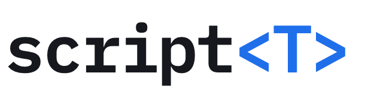

<h1>
  <picture>
    <source media="(prefers-color-scheme: dark)" srcset="web/site/wordmark-dark.png">
    " width="320">
  </picture>
</h1>

**0.1.7** · [scriptt.ai](https://scriptt.ai) · [roadmap](ROADMAP.md)


scriptt shows you how Claude Code understood your message before it starts work, and sends Claude back when it skips
a step.

`.scriptt/world.py` records what you and Claude both believe about your project: the things you work on, the requests
you make, and what each request takes and gives back, as ordinary Python types. When you send a message, a small local
decision model, d1, compares it with that record before Claude reads it. Each request becomes a typed call, and every
word gets a type. Claude receives this block with your message:

```
scriptt: d1 read this message against .scriptt/world.py (reading 16618bf0). Obligations: 2.
#0 redesign(surface='the mod') -> Later[Surface]  (pending)   "Redesign the mod."   evidence: a file written
#1 test(subject='the search') -> Observed   "Test the search too."   evidence: a command that runs and exits 0
Declared in world.py:
  def redesign(surface: Surface) -> Later[Surface]   change how the page or the interface looks, or how its information is ordered
  def test(subject: Subject) -> Observed   test or verify that something works
  Surface = 'the page' | 'the site' | 'the website' | 'the ui' | 'the mod' | 'the pane' | 'the visualization'
  Subject = Surface | Code | Path
Words with no sure kind in world.py (3 of 5 pieces): Redesign the; Test the; too. If they matter, ask what they are, or propose types for .scriptt/world.py.
At the end of the turn each obligation is checked: work by evidence only (the commands you ran, the files you wrote; your words are not evidence of work), an answer or a rule by d1's judgment of your reply.
```

This block comes from the hook with the scripted d1 of `next/test_scriptt.py`. When Claude stops, the Stop hook looks
in the transcript for a file written or a command run for each call, and sends Claude back at most twice for calls with
neither.

**The public release of d1 is pending.** scriptt needs a d1 endpoint that you already have. With no d1, each hook
prints 1 line on stderr and Claude Code goes on.

## Install

In the folder of your project. It needs Python 3.14 or later and uses only the standard library.

```bash
curl -fsSL https://scriptt.ai/install.sh | sh
```

The installer writes 5 files to `.scriptt/` (`harness.py`, `agree.py`, `scriptt16.py`, `world.py`, `SKILL.md`), adds a
`UserPromptSubmit` and a `Stop` hook to `.claude/settings.local.json`, and copies the skill to
`.claude/skills/scriptt/`. An existing `.scriptt/world.py` is kept. [scriptt.ai](https://scriptt.ai) has a prompt that
you paste into Claude Code instead: it installs, asks where d1 runs and proposes a `world.py` for your project.

Say where d1 runs in `.scriptt/config.json`:

```json
{"url": "http://127.0.0.1:8791/v1/systemone", "body": {"model": "d1-2B-MLX-8bit"}, "block": true}
```

- `url`: a System One endpoint (`.../v1/systemone`) or a CoreAI endpoint (`.../v1/decide`).
- `key` or `key_file`: a Bearer token, if the endpoint needs one.
- `body`: fields added to each request, such as the model.
- `block`: `true` (the installer's default) lets the Stop hook send Claude back.

A `world.py` written for 0.1.6 has faults under 0.1.7. `python3.14 .scriptt/harness.py world` lists them, and the hooks read nothing until they are fixed.

## The board

`python3.14 .scriptt/harness.py serve` opens the board on http://127.0.0.1:8787. It shows each message with every word
linked to its type. Open a link to see its type in the world, its members, and d1's options with their probabilities.
Drag a type or a constructed type such as `Later[Surface]` onto any words, or a word, a member or an earlier result into
any argument. The engine previews each drop. Accept keeps it as your correction, which every rerun keeps, or marks
invalidated with the reason. [scriptt.ai](https://scriptt.ai) runs the same board on its own text, with the engine
running in the browser through Pyodide.

The Claude desktop app can draw the reading on each message you type with a plugin, not yet tested in the app: see [mod/](mod/README.md).

### Tag your own messages

1. Send messages to Claude Code in the project as usual. The hook reads each one and saves it to `.scriptt/events.jsonl`.
2. Run `python3.14 .scriptt/harness.py serve` and open http://127.0.0.1:8787. The board opens on your latest message. With
   the desktop plugin, the link under a message opens the board on that message.
3. Click a word. The pane shows its type in your world, the functions that take or return that type, and d1's options
   for the word with their probabilities.
4. Retag it: click another of d1's options, drag a type or a `Later[…]`, `Many[…]` or `Maybe[…]` type onto any words,
   or drag the ends of a link to cover more or fewer words. Drag words, a member or an earlier result into an argument.
5. ✓ (or `a`) saves the change as your correction, ✕ (or `esc`) cancels, and `z` undoes. Every rerun keeps your
   corrections, or marks one invalidated with the reason.

## This repository

| Path | What it holds |
|---|---|
| [next/](next/) | The engine: `agree.py` (the world's types), `scriptt16.py` (the reader), the example world, `notebook.py` (1 message through the reader, in marimo) and `test_scriptt.py`. |
| [scriptt/](scriptt/) | `harness.py` (the hooks, the installer and the local server), the starter `world.py` and `SKILL.md`. |
| [web/](web/) | scriptt.ai and the board. `sh web/build.sh` builds `web/public/`. `web/make_demo.py` reads the demo message with a real d1. `web/social/render.sh` renders the social card and icons. |
| [mod/](mod/README.md) | The mod for the Claude desktop app, installed as a plugin. |
| [ROADMAP.md](ROADMAP.md) | What comes next. |

Read the code in this order: `scriptt/world.py`, then the module docstring of `next/scriptt16.py` (the reader's states
and transitions), then `scriptt/harness.py` (`render()` is what Claude receives, `stop()` is the check).

Test: `python3.14 next/test_scriptt.py`.

Remove scriptt from a folder: delete the 2 `harness.py` entries from `.claude/settings.local.json`, then
`.claude/skills/scriptt/` and `.scriptt/`.
