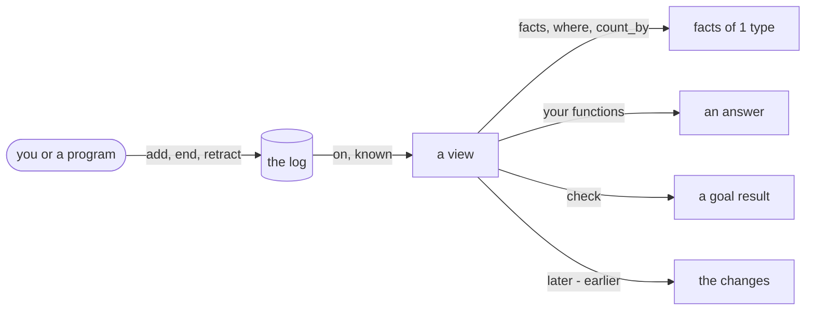

# Mental model

A world keeps facts in a log. A function reads a view of the log and gives an answer. This page gives the
words of the library and the questions to answer before you start.

## A world in 5 steps

The example is a to-do app with 1 task, "Send the report".

1. A **type** gives the fields of 1 kind of fact. The type `Task` has an id, a title and a done flag.
2. A **fact** is 1 statement of a type. The statement "task `t2` has the title Send the report" is a fact.
3. The **log** keeps every fact that you add, in sequence. Each `add` writes 1 **entry**. The log never
   changes an entry. `but` makes a new version of a fact, and `add` writes it.
4. A **view** contains the facts that are true on 1 date and known by 1 time. In the
   [quickstart](quickstart.md), `todo.on("4 Nov 2026")` is the view of 4 Nov.
5. A **function** reads a view and gives an answer. `open_tasks(view)` gives the tasks that are not done.

## Terms

| Term | Meaning | In code |
|---|---|---|
| world | The types, the log and the functions of 1 domain. | `World.new(Task)` |
| type | The fields of 1 kind of fact. | `class Task(Fact)` |
| fact | 1 statement of a type, with its source and its dates. A fact never changes. | `Task(id="t2", ...)` |
| key | The fields that name the thing that a fact is about. | `id: Key[str]` |
| version | A later fact with the same key. | `todo.add(task.but(done=True), ...)` |
| reference | A field that contains the key of a different fact. | `list: Ref[TodoList]` |
| source | Where a fact came from. | `add(..., source="me")` |
| true from | The date from which a fact is true. | `add(..., true_from="3 Nov 2026")` |
| known | The time at which you got a fact. | `add(..., known="4 Nov 2026 10:00")` |
| log | Every fact that you added, in the sequence that you added them. | `todo.size` (the number of entries) |
| entry | 1 row of the log. It is a fact added, ended, retracted, joined or renamed. | `todo.history(task)` |
| view | The facts true on 1 date and known by 1 time. | `todo.on(date).known(time)` |
| end | To give the date on which a fact stops being true. | `todo.end(...)` |
| retract | To mark a fact as a mistake. | `todo.retract(...)` |
| function | A Python function that reads a view and gives an answer. | `def open_tasks(view)` |
| goal | A rule and the number of facts that must agree with it. | `Goal(...)` |
| goal result | The result of a goal on 1 view: met or not met, and the facts that do not agree. | `view.check(goal)` |
| problem | A reference to a fact that does not exist. | `view.problems()` |
| changes | The facts that differ between 2 views. | `later - earlier` |
| `Facts` | A table of facts or rows with methods such as `where` and `count_by`. | `Facts[Task]` |
| `Row` | 1 table row with the columns that you name. | `Row(status="open", tasks=2)` |
| t-string | A Python 3.14 string with the prefix `t`. It keeps each `{value}` apart from the text. | `t"{task} is late"` |

## 4 questions before you start

1. **Which kinds of thing do you keep?** Make 1 type for each kind. A to-do app has lists and tasks.
2. **Which fields name each thing?** Mark them with `Key`. A task has an id. A list has a name.
3. **From when is each fact true?** Give `true_from`. If you give no date, the fact is true for all time.
4. **When did you get each fact?** Give `known`. If you give no time, the library uses the time of the call.

## Limits

- A true-from date has no time of day.
- `World.new(Task)` keeps the log in memory. `World.open("todo.duckdb", Task)` keeps it in the file
  `todo.duckdb`.
- `sql` runs 1 query that reads. It cannot change the log.
