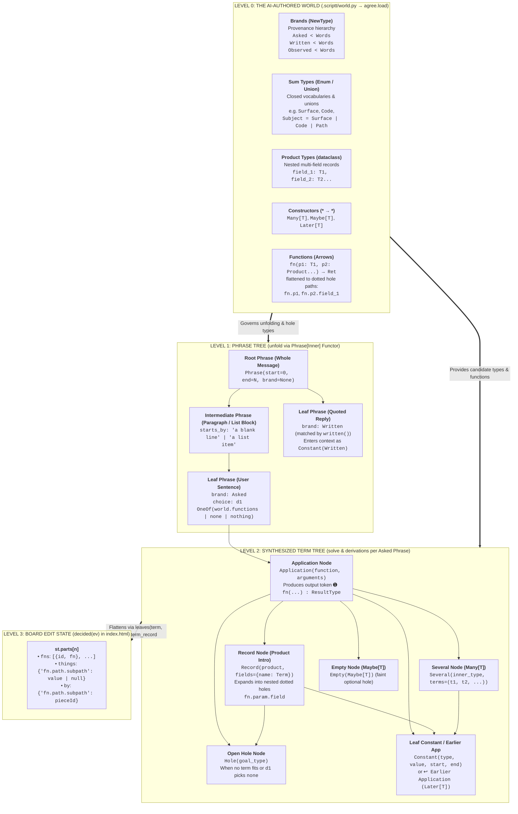
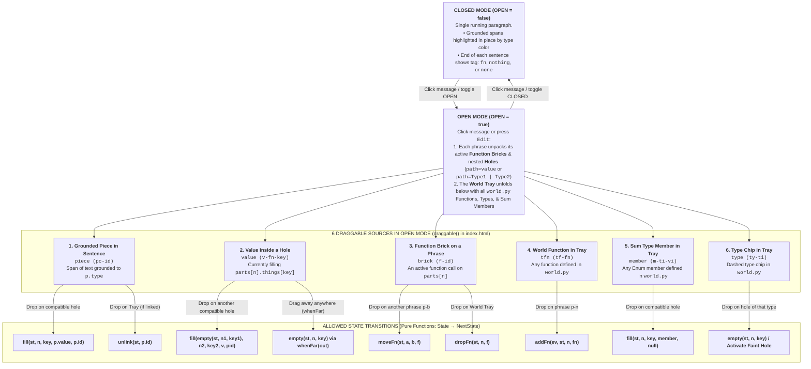

# UI Inventory, User Notes, Critique & Architectural Diagrams

Generated: 2026-11-10

---

## 1. Directory Inventory of All UI Files

### A. Existing Production / Repo UI (`scriptt-release`)
1. **[`/Users/max/Documents/scriptt-release/web/public/index.html`](file:///Users/max/Documents/scriptt-release/web/public/index.html)** *(39,975 bytes — Original Dragology 0.2.0 Web Board)*
   - **What it is:** The existing Dragology-powered SVG web board served by `harness.py serve` on `http://127.0.0.1:8787`, reading `WORLD` and `EVENTS` from [`web/public/data.js`](file:///Users/max/Documents/scriptt-release/web/public/data.js) and rendering via [`web/public/vendor/dragology-0.2.0.iife.js`](file:///Users/max/Documents/scriptt-release/web/public/vendor/dragology-0.2.0.iife.js).
   - **How it works:**
     - **Closed mode (`OPEN = false`):** Renders the message as a single continuous paragraph with colored spans (`piece`) and sentence-end function tags (`tag`).
     - **Open mode (`OPEN = true`):** Splits into a 2-column layout (sentence bubbles on the left, function `brick`s and `hole`s on the right) plus the dynamic `WORLD` tray below (functions, dashed type chips, sum type members).
     - **Key architectural rule (Line 133):** `// Every word drawn below comes from the record (events.jsonl), from the world (world.py) or from the message. Nothing names a type or a function of a world.`

2. **[`/Users/max/Documents/scriptt-release/mod/hooks/row.tsx`](file:///Users/max/Documents/scriptt-release/mod/hooks/row.tsx)** *(Claude Desktop / Claude Code inline hook renderer)*
   - **What it is:** The inline message decorator inside the Claude Desktop app (installed via `/plugin install scriptt`).
   - **Current state:** Static inline renderer for `form 2` / `form 3` records; does not yet expose the interactive Dragology state transitions or `form 4` recursive `Term` trees.

3. **[`/Users/max/Documents/scriptt-release/next/notebook.py`](file:///Users/max/Documents/scriptt-release/next/notebook.py)** *(Marimo interactive notebook — specifically `drawn(reading)` at lines 643–730)*
   - **What it is:** The 4-part literate Marimo notebook explaining `agree.py` and `scriptt16.py`. Cell `drawn(reading)` folds a `Reading` (`form 4`) into a single HTML paragraph with inline badges (`➊ redesign ➔ Later[Surface]`), colored constants (`the mod : surface ∶ Surface`), and trailing sockets (`◻ path: Type` or `path ↩ ➊ ...`).

---

### B. Prototype UI Files Created During This Session (and Their Iteration History)
4. **[`/Users/max/Documents/scriptt-release/web/public/prototype.html`](file:///Users/max/Documents/scriptt-release/web/public/prototype.html)** *(74,108 bytes — Standalone copy in `web/public/`)*
5. **[`/Users/max/.gemini/antigravity/brain/0f6d8ab7-d06e-448c-9ee9-bcab04e07516/scriptt_unified_canvas.html`](file:///Users/max/.gemini/antigravity/brain/0f6d8ab7-d06e-448c-9ee9-bcab04e07516/scriptt_unified_canvas.html)** *(74,108 bytes — Artifact copy)*
6. **[`/Users/max/.gemini/antigravity/brain/0f6d8ab7-d06e-448c-9ee9-bcab04e07516/inline_paragraph_demo.html`](file:///Users/max/.gemini/antigravity/brain/0f6d8ab7-d06e-448c-9ee9-bcab04e07516/inline_paragraph_demo.html)** *(74,108 bytes — Chat `<agent-embed>` copy)*

---

## 2. Saved User Notes & Feedback Across All 3 Prototype Iterations

### Iteration 1 Critique (User Rating: 2/10)
- **What worked:**
  - Highlighting multiple items in place.
  - Starting to use different types in `Subject`.
  - Showing how the prompt is compiled and what is sent to `d1`.
- **What failed:**
  - **No visual alphabet:** Impossible to unpack what `notebook` or `Later` is, what the probability numbers mean, what blue means, what the circled numbers (`#1=#2`, `➊`) mean, or why outlines/colors/colons (`:`) vs. arrows (`➔`) look the way they do ("nonsense slop").
  - **Fake `context[n]` trace:** Wrote `context[n]` at the bottom as a flat list of pills, which does not compile into or look anything remotely like a real execution/derivation trace (`Agent(context[n]) => context[n+1], process_executions`).
  - **No real dragging:** Clicking didn't do anything meaningful and nothing could actually be dragged in the inline widget.
  - **Ignored core inspirations:**
    - **Dragology (`permutation-lab`, `animate-algebra-tree`):** Continuous state-manifold interpolation (`d.between`) over algebraic structures.
    - **Ink & Switch Potluck (`all-ingredients`):** Plain text stays plain text; live extraction and computation happen quietly in place.
    - **Ink & Switch Embark:** Structured progressive computation inline with prose.
    - **Graspable Math (`activities.graspablemath.com`):** Terms in the expression *are* the manipulable algebraic objects.

### Iteration 2 Critique (Graspable English Canvas v1)
- **User Notes:**
  1. *"For the top panel, the graspable English canvas: I like being able to drag things together to show they are related in some way. I wish I could also drag things out of the context."*
  2. *"The dragging itself and the synthesized states is very hard to use and visually unclear."*
  3. *"I like the state reset. I like the derivation. I like the sockets."*
  4. *"Why are many/bind/whatever the only things we're showing though? What about the types and branding and kinds and how we organize the world? Like where why aren't those here? And why don't those have different things in here? And how would we show if we were showing the search process the search happening to visualize it? Because I feel like we should be able to visualize the search happening in the same language if we want to."*
  5. *"I don't have any clue what two [Panel 2] is. And three [Panel 3] is unusable too. So try those again."*

### Iteration 3 Critique & Self-Critique (World Grid + Search Stepper Canvas)
- **User Note:**
  - *"I'll let you self-critique this one. Uh I have no idea what it is if I'm being honest. Don't rewrite anything, just write a self-critique with all the feedback I've given you."*
  - *"When I click on something, there is an explicit world that is related to each of these words or phrases or whatever it is, each of the tag things that is opening up and they are built into the data structure with levels and the AI is responsible for tagging them and building up these levels and hierarchy itself. Isn't it? Like, isn't that how this works?"*
- **Distilled Self-Critique of Iteration 3:**
  1. **Shattered the English paragraph into metadata cards:** Broke the message into 5 separate gray cards with headers like `Phrase 1 · Brand: Asked < Words (start of message)`. Destroyed reading flow instead of keeping a Potluck-style paragraph where clicking a word/phrase progressively unfolds its level in the hierarchy.
  2. **Triplicated every entity on screen:** Drew `"the mod"` three separate times in Panel 1 (in the sentence, inside the socket below it, and in a "Context Shelf" below that) plus a fourth time in Panel 3, connected by spaghetti lines. In Graspable Math and Dragology's `animate-algebra-tree`, **there is only one copy of a term**.
  3. **Built a Windows 95 "Unbind / Evict" Trash Box (`⊖ DRAG HERE TO UNBIND / EVICT`):** Instead of using Dragology's native `whenFar(out)` (where pulling a term away into open space naturally unbinds it, as `index.html:379` already does for `value`), Iteration 3 forced the user to drag items into a red corner box.
  4. **Hardcoded `world.py` into a 5-column textbook glossary:** Instead of deriving the UI dynamically from `WORLD` (`events.jsonl` + `world.py`, as `index.html:133` mandates) and letting clicking a phrase/word unfold its relevant slice of the hierarchy, Iteration 3 dumped a static 5-column cheat sheet (`1. Kinds`, `2. Brands`, `3. Sum Types`, `4. Constructors`, `5. World Functions`).
  5. **Turned "Visualizing Search" into a text-caption slideshow (`Step 1/6..6/6`):** Instead of showing candidate terms physically testing against holes in the same visual language, it hid/showed badges and printed a paragraph of Python documentation at the bottom.

---

## 3. Additional Architectural Critique: What the Next Real UI Must Do

When we synthesize your insight—*"When I click on something, there is an explicit world that is related to each of these words or phrases... built into the data structure with levels and the AI is responsible for tagging them and building up these levels and hierarchy itself"*—with `web/public/index.html` and `next/scriptt16.py`:

1. **Zero Hardcoded Types (`index.html` Line 133 Principle):**
   - The UI must never hardcode `Surface`, `Code`, `redesign`, or a static 5-column table. Every type, brand, sum member, product field, and function comes dynamically from the AI-authored `world.py` (`WORLD`) and the `form 4` reading in `events.jsonl`.
2. **Progressive Unfolding by Clicking (Levels of the Hierarchy, Not All-At-Once Noise):**
   - **Level 0 (Reading the Message):** Clean running English paragraph (Potluck style). Grounded spans have subtle underline marks; each sentence has its quiet outcome pill (`redesign`, `show`, `test`, `explain`).
   - **Level 1 (Clicking a Phrase or Verb):** Opens *only* that phrase's synthesized `Application` frame and its immediate parameter sockets (`surface`, `subject`), plus the local/context candidates that `derivations()` found for those sockets.
   - **Level 2 (Clicking a Socket or Type):** Opens the `world.py` definition for *that specific type*—if it's a `Product`, it unfolds the nested field sockets; if it's a `Sum` (`Subject = Surface | Code | Path`), it unfolds the union branches and enum members so you can drag one in; if it has multiple candidates, it unfolds `d1`'s probability bars and prompt template right there.
3. **True Dragology `whenFar` & `d.between` (No Trash Cans, No Duplicate Clones):**
   - Pulling any bound term *away* from its socket (`whenFar(emptyState)`) detaches it back into open space.
   - Dragging a term toward a compatible socket (`d.between`) interpolates the layout continuously without duplicating the word into three separate shelves.

---

## 4. Reference Diagrams: The 4-Level AI-Built Hierarchy & Allowed Transitions

### A. The 4-Level Hierarchical Data Structure

### B. Complete State-Transition Workflow Chart

